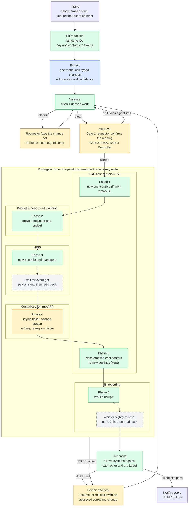
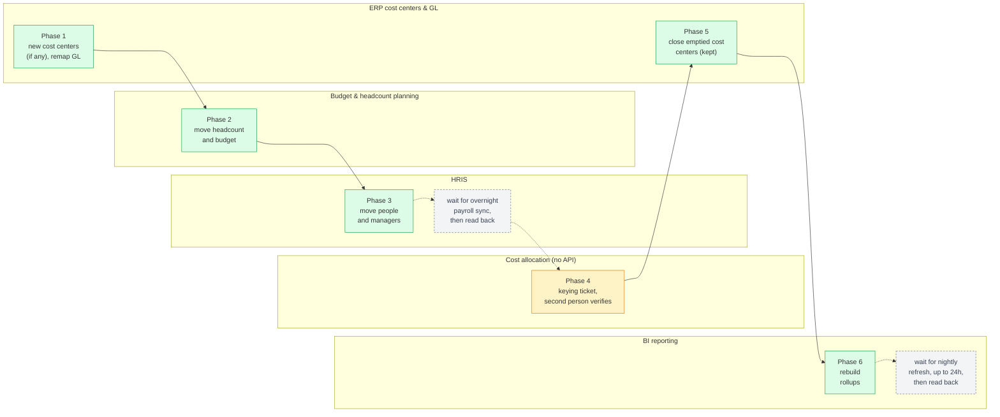

# Reorg Change Compiler - Strategy

## Summary

**Problem.** (See the [brief](./BRIEF.md).) A reorg arrives as a Slack message, an email or a doc. One person then updates five systems by hand: ERP cost centers and GL, budget and headcount planning, the HRIS, cost allocation, and BI reporting. They work in an order that exists only in their head, and mistakes surface weeks later in the financials.

**Solution.** The Reorg Change Compiler turns the message into a typed change set and checks it against every system. It works out the steps nobody wrote down, then runs them in a fixed order, with a named person approving. Finally it reconciles all five systems against each other on the day of the change, not at month-end.

**Core insight: an agentic pipeline, with people at the gates.** One model call reads the message. Deterministic code validates it, works out the implied steps and orders them. People approve before anything is written. Typing changes into five systems isn't the hard part. The hard part is doing it in the right order, with checks and balances that validate each change and confirm it reached every system. Today that order lives in one person's head. The pipeline runs on that order written down as data, with a reason for every phase, the same way every time:

1. **ERP cost centers & GL:** create a cost center only if it's new (most already exist), and remap the GL.
2. **Budget & headcount planning:** move approved headcount and budget.
3. **HRIS:** move people and managers, on the effective date.
4. **Cost allocation (no API):** a person keys the rule changes, including end dates for closing cost centers; a second person checks them.
5. **ERP:** close emptied cost centers to new postings. They're never deleted, so past periods still report.
6. **BI reporting:** rebuild the reporting rollups.
7. **Reconcile:** check that all five systems agree.
8. **Notify:** tell the people affected.

See [Order of Operations](#order-of-operations).

**Where people stay in the loop.** The model only reads the message; it can't approve, order or write anything. People act at five points:
1. **Gate-1:** the requester confirms the model's reading of their message, on every change.
2. **Gate-2 (FP&A) and Gate-3 (the Controller):** they approve budget and books changes.
3. **Blockers:** the requester fixes anything validation blocks, or routes it out.
4. **The keying step:** a person keys the change into the system with no API, and a second person verifies it.
5. **Failures:** a person decides whether to resume or roll back a change that stops partway.

**Key decisions.**
1. **The [order of operations](#order-of-operations) is fixed data, not model output.** Any new cost center must exist before people move into it, or payroll posts to a [suspense account](#appendix-glossary). Budget moves before people. A cost center is closed only once it's empty, and it's never deleted, so past periods keep reporting.
2. **People approve every change in this version.** Automation isn't all-or-nothing: approvals can be automated per change type once evals show the reading is reliable and confidence is high. See [Path to automation](#path-to-automation).
3. **Names and pay never reach the model.** They're swapped for IDs and tokens first. An ambiguous name (two people called Priya) is flagged, not guessed.
4. **Every write is read back.** A phase counts as done only when the system shows the new value. Systems that update in an overnight batch wait, up to 24 hours, before the next phase starts.
5. **Rolling back is a human decision.** There's no cross-system transaction to undo automatically. If a run stops partway, a person chooses to resume or to roll back what was applied, and the roll-back is an approved change that runs through the same order.

**Scope.** In scope: reorg changes (team moves, manager changes, cost-center splits and merges, headcount transfers), from capture to reconciliation. Out of scope: hires and terminations; executing pay changes, which are detected and routed to the comp process; retroactive changes into closed periods; multiple entities or currencies; and real system connectors. See [Non-goals](#non-goals-out-of-scope).

**Assumptions.** See [Assumptions and Open Questions](#assumptions-and-open-questions). The one that shapes the most: accuracy comes before automation in this first pass.

**Prototype.** The [live page](https://niveam.github.io/ReorgChangeCompiler/) runs on one fictional 24-person company, with three sample messages and all five systems simulated. Its steps carry the same names as the pipeline below. The model call is real when you add an API key. Validation, approvals, ordered propagation, the keying ticket and reconciliation are working code with 17 tests.

## Goals and Non-Goals

### Existing state and pain points

Each pain point is numbered PP#1 to PP#8. The requirements below cite them by that number.

1. **PP#1.** A reorg arrives as a Slack message, an email or a doc. One person then updates five systems by hand.
2. **PP#2.** The order isn't written down (addressed by the [order of operations](#order-of-operations)). It lives in that person's head, and the runbooks that do exist are partly out of date.
3. **PP#3.** Errors surface weeks later, usually in the financials after the period has closed: payroll posted to suspense, false variances, missing allocations.
4. **PP#4.** There's no single record of a change: no typed change set, no version tied to an approval, and no check that the systems agree with each other.
5. **PP#5.** Key-person risk. If the person who knows the [order](#order-of-operations) is out, the process stalls or someone guesses.
6. **PP#6.** Pay and names travel informally, in forwarded messages with no redaction and no access control.
7. **PP#7.** Approvals are informal. A "looks good" in chat isn't tied to a specific version of the change.
8. **PP#8.** The process takes days per reorg, and month-end rework adds more.

### Goals (functional requirements)

Functional requirements are numbered FR#1 to FR#6. The design cites them by that number.

1. **FR#1 - Capture and extract.** Take reorg changes as freeform text and keep the original as the record of intent. Turn it into a typed change set in which every change carries a source quote and a confidence score. [addresses PP#1, PP#4]
2. **FR#2 - Validate and derive, with a person on every failure.** Check each change against every system of record before writing anything, and work out the implied work: budget transfers, GL remaps, closing emptied cost centers. When validation fails, nothing moves. The blocker goes to the requester, who fixes the change set or routes it out (for example, a pay change goes to the comp process). [addresses PP#2, PP#5]
3. **FR#3 - Propagate in the order of operations.** Apply an approved change to each system in the fixed [order of operations](#order-of-operations), Phase 1 to Phase 8, with the reason for each phase recorded. Read back every write before the next phase. Re-check for outside changes before each step, and stop for a person to decide (resume or roll back) on drift. [addresses PP#1, PP#2, PP#5]
4. **FR#4 - Approval gates.** Require a named approver's signature, tied to the exact change-set version and a snapshot of the systems, before anything dependent runs. Any edit voids every signature.
   - **Gate-1:** the requester confirms the reading.
   - **Gate-2:** FP&A approves budget moves.
   - **Gate-3:** the Controller approves changes to the books.

   [addresses PP#4, PP#7]
5. **FR#5 - Systems with and without an API.** Where an API exists, apply through a connector. Where it doesn't, issue a field-level keying ticket (old value to new value, no free text), and have a second person verify it. [addresses PP#1]
6. **FR#6 - Reconcile.** After propagation, check every system against the others and against the approved target, independently of the plan. Surface drift by system and record. [addresses PP#3, PP#4]

### Non-functional requirements

Non-functional requirements are numbered NFR#1 to NFR#3.

1. **NFR#1 - PII exposure minimization.** Names, pay and contact details never reach the model. They're replaced with tokens before extraction, and the originals stay in a local vault. [addresses PP#6]
2. **NFR#2 - Auditability.** Log every step in an append-only record: the raw message, each change-set version, each signature, step receipts, keying records and reconciliation results. *The prototype doesn't store this log yet; see [Assumptions](#assumptions-and-open-questions).* [addresses PP#7]
3. **NFR#3 - Idempotency.** A retried write never applies twice. *The prototype proves this with an in-memory ledger. A production connector needs the key stored durably.* [supports FR#3, FR#5]

### Non-goals (out of scope)

Out-of-scope items are numbered OOS#1 to OOS#7.

1. **OOS#1 - Real production connectors.** The systems of record are simulated. The connector interface is defined so real ones can drop in later. Without them, the cycle-time gain (PP#8) is unproven.
2. **OOS#2 - Executing pay changes.** They're detected and routed to the comp process. The model never sees an amount.
3. **OOS#3 - Hires, terminations and leaves.** That's a different lifecycle with different owners. The brief's examples are all reorg-type changes.
4. **OOS#4 - Retroactive changes into closed periods.** These are blocked and routed to a Controller-led adjustment.
5. **OOS#5 - Multiple entities, currencies and intercompany allocations.** A single entity keeps the design tractable; the brief is silent on this.
6. **OOS#6 - Screen automation (RPA) for the system with no API.** The person-keyed, verified ticket replaces it. See [Alternatives](#alternatives-considered).
7. **OOS#7 - Auto-approval in version 1.** Every change gets a person's sign-off. Automation comes later, earned per change type through evals. See [Path to automation](#path-to-automation).

## Approach and Design

One pipeline: Intake, PII redaction, Extract, Validate, Approve, Propagate, Reconcile. The [live prototype](https://niveam.github.io/ReorgChangeCompiler/) uses the same names. Propagate is where the [order of operations](#order-of-operations) runs. Each component is described in [Components and interfaces](#components-and-interfaces).

*Legend:* 🟦 the one model call · 🟨 person decides or acts · 🟩 deterministic code · ⬜ wait for an overnight batch, then read back (dashed) · 🟪 start / end

- **Intake.** Accept the message as it arrives and keep the original as the record of intent. [FR#1]
- **PII redaction.** Before the model sees the text, replace names with employee IDs and pay and contact details with tokens. Flag ambiguous first names and unknown people for a person to resolve. [FR#1, NFR#1]
- **Extract (the one model call; a person checks it).** The model reads the redacted text into a typed change set, with a source quote and a confidence score per change. It has no tools and no way to write. **The requester reviews the reading and corrects it before signing Gate-1.** Low confidence and open questions are put in front of them. [FR#1]
- **Validate.** Check the change set against every system before anything is written, and work out the steps nobody wrote down. **A blocker stops everything and goes to the requester to fix or route out.** Validation is the only route to a write. [FR#2]
- **Approve.** Gate-1, the requester's sign-off on the reading, is always required. Gate-2 (FP&A) and Gate-3 (the Controller) are added when the change touches budget or the books. Each signature is tied to the change-set version and a snapshot of the systems, and any edit or outside change voids it. [FR#4]
- **Propagate.** Run Phases 1–6 in the [order of operations](#order-of-operations). Read back every write before moving on, and wait for systems that update overnight. Where there's no API, a person keys the change from a ticket and a second person verifies it. **On drift or failure the run stops, and a person decides what happens next.** [FR#3, FR#5]
- **Reconcile.** Check every system against the others and against the approved target, independently of the plan, so it catches errors the plan didn't anticipate. A failed check goes to a person and keeps the change out of COMPLETED. [FR#6]

Design decisions that carry the approach:
- **The [order of operations](#order-of-operations) is data, not inference.** The model never plans it, so it's identical every time and reviewable by Finance.
- **The model proposes; code and people dispose.** Every consequential step after extraction is deterministic code or a named signature.
- **Rolling back is a human decision.** These systems share no commit protocol, and a person keying a value can't take part in one. So when a run stops partway (PARTIALLY_FAILED), a person chooses between two options:
  - **resume** once the cause is fixed;
  - **roll back** through a compensating change set, for example "move these people back". It's typed, approved at the same gates and run in the same order.

  The system never rolls back on its own.
- **The system with no API is a connector behind a ticket.** It has the same interface as the others (preview, apply, read back), except that a person does the apply and a second person does the read-back, with an ERP-side check that allocations still total 100%.
- **Connectors are an interface in the prototype.** The simulated systems plug into preview, apply and read back. Real connectors drop in later without changing the design.

### Order of Operations

This is the heart of the design. Today the order lives in one person's head; here it is written down, with a reason for every phase. The runbook is data, not something the model decides. Each phase starts only when every earlier phase is done and read back. Before each step, the systems are re-checked for outside changes.

*Legend:* 🟩 code step · 🟨 person acts · ⬜ wait for an overnight batch, then read back (dashed in the diagram)

| Phase | System | Why this order | Timing and read-back |
|---|---|---|---|
| 1 | ERP cost centers & GL | Most cost centers already exist. Any new one must exist before anything references it, or payroll posts to a suspense account. | API, effective-dated. Read back any new cost center and the GL mapping. |
| 2 | Budget & headcount planning | Move headcount and budget before people, so the people move doesn't show as a false variance. | API. Read back the approved headcount and budget per cost center. |
| 3 | HRIS | People and manager changes, once their cost centers and budget exist. | Scheduled for the effective date. The payroll sync may run overnight, so read back after it runs. |
| 4 | Cost allocation (no API) | Rules must cover every cost center that will carry cost before the period's allocation run. A closing cost center's rule is end-dated, not deleted. | A person keys it within an SLA, before the allocation run. A second person reads it back against the ticket. |
| 5 | ERP close | Close a cost center to new postings only once nobody is assigned to it. It's never deleted: its history stays in the ERP and in reporting. | After Phase 3 is effective and read back. |
| 6 | BI reporting | Rebuild rollups from the final state of the other systems. | Often a nightly batch, up to 24 hours. Read back after the refresh. |
| 7 | Reconcile | Check all five systems against each other and the approved target. | After Phase 6, again at effective date + 1 day, and before the allocation run. |
| 8 | Notify | Tell affected people only after reconciliation passes. | Last. |

**If something goes out of order or drifts, the run stops; it never pushes forward on its own.** Examples are someone editing the HRIS directly, a batch job failing, or a keyed value not matching the ticket. A person decides: resume once the cause is fixed, or roll back with an approved correcting change. Either way the change goes back through Validate and Gate-1 as a new version, then re-enters the order at the right phase. Phases already done aren't repeated, because each write has an idempotency key.

Each wait for an overnight batch is its own labelled box in the diagram, followed by a read-back. The prototype applies every phase instantly. Batch delays and waiting for them are part of the production design, not the simulation.

### Components and interfaces

| Component | Job | Who or what does it |
|---|---|---|
| **Intake** | Stores the raw message, stamps the requester and limits who can see the change | Code |
| **PII redaction** | Turns known names into employee IDs. A shared first name becomes `[AMBIG:E300\|E530]` and an unknown name becomes `[UNKNOWN_PERSON_n]`. Pay, emails, phone numbers and government IDs become tokens. | Code |
| **Extractor** | Reads the redacted text and a roster of IDs, titles, managers and cost centers, and returns a typed change set. The requester reviews and corrects it at Gate-1. | **The one model call**, checked by a person |
| **Validator** | Applies the change set to a snapshot of the org and runs the rules. It works out the implied work and computes headcount and cost impact per cost center, never per person. Blockers go to the requester. | Code (model-based evals possible later) |
| **Gate service** | Picks the gates, collects signatures and voids them on any change | Code; people sign |
| **Runbook compiler** | Turns the approved change set into Phases 1–8 of the [order of operations](#order-of-operations) | Code |
| **Orchestrator** | Runs the phases in the [order of operations](#order-of-operations), reads back every write, waits for batch systems, and stops for a person on drift or failure | Code |
| **Connectors** | Talk to each system through one interface (preview, apply, read back), including the person-keyed one | Code, plus people for the system with no API |
| **Reconciler** | Reads all systems and checks the rules that span them. It never writes. | Code |
| **Audit log** | Append-only record of everything | Code |

Main interfaces:
- **Change set:** typed changes (`move_team`, `move_employee`, `change_manager`, `create_cost_center`, `merge_cost_centers`, `transfer_headcount`, `close_cost_center`), each with an effective date, a source quote and a confidence score.
- **Connector:** `preview(ops)`, `apply(ops, idempotencyKey)`, `readBack(keys)`. Every system implements it, including the person-keyed one.
- **Signature:** gate, signer, change-set hash and system snapshot. Any edit or outside change voids it.
- **Keying ticket:** field-by-field old and new values, bound to a snapshot and a payload hash, verified by a second person.

Agentic building blocks the design relies on:
- **One structured-extraction call.** The LLM reads freeform text into a typed change set against a fixed schema, with a source quote and a confidence score per change. It has no tools, no memory and no way to write.
- **Deterministic tools around it.** The validator, runbook compiler and reconciler are plain code. They make the decisions; the model doesn't.
- **A PII guardrail before the model.** Redaction runs in code, so the model only sees IDs and tokens.
- **Human-in-the-loop gates.** Each signature is bound to one change-set version and a snapshot of the systems.
- **A person as a tool.** For the system with no API, the orchestrator issues a keying ticket to a person and waits; a second person verifies. It sits behind the same connector interface as the systems with APIs.
- **A verification loop.** Every write is read back, and reconciliation checks the systems independently of the plan.
- **Evals and shadow mode.** How autonomy is earned later (see [Path to Automation](#path-to-automation)).

### Where a person stays in the loop, and why

| Where | Who | Why a person |
|---|---|---|
| **Gate-1:** confirm the reading | The requester (HR business partner) | The input is freeform. Misreading intent is the highest-blast-radius error, and only the author can rule it out. |
| **Gate-2:** budget and headcount | FP&A | Whether budget follows people is a business call. |
| **Gate-3:** the books | The Controller | Cost-center, GL and allocation changes alter the books, and errors surface weeks later in reported numbers. |
| **Blockers** | The requester | Validation found something only the requester can fix or route out, such as a missing date, a pay change or a new hire. |
| **Keying and verification** | A Finance Ops keyer, then a second person | The allocation engine has no API, and a second person catches keying errors before month-end. |
| **Drift or failure** | A person decides: resume or roll back | There's no cross-system transaction, so undoing a change is a business decision. |

### Path to Automation

Automation isn't all-or-nothing. This version keeps a person on every approval, because there's no evidence yet about how often the model's reading is right. Autonomy is earned one change type at a time, with evidence:

1. **Shadow mode.** The compiler runs on real requests while people still make the changes. Its plans are compared with what people actually did, and that comparison builds a labelled set of real reorg messages.
2. **Evals.** Every prompt, model or rule change is scored against that set. The measures are field-level accuracy (wrong-person errors weighted highest), whether confidence is calibrated (does 0.9 mean right 90% of the time?) and the Gate-1 correction rate.
3. **Thresholds per change type.** When a change type clears an agreed bar on those measures over a sustained period, its Gate-1 can move from approve-before to review-after. An example is a manager change inside one cost center. The requester is notified and can reverse it with a correcting change. Budget and books (Gate-2, Gate-3) stay with people longest.
4. **Automatic fallback.** If accuracy drops or the correction rate rises, that change type goes back to full approval.

Version 1 deliberately has no auto-approval. Take "Move Priya's team under Marcus" in an org with two Priyas: a confident guess could shift headcount and budget to the wrong cost center before anyone notices. Gate-1 catches that today; evals have to prove they'd catch it before the gate is relaxed.

## Alternatives Considered

None of these are in the prototype. Each is marked **Deferred** (could come in a later iteration) or **Discarded** (rejected for this design).

1. **A structured intake form instead of freeform text.** *(Deferred)*
   *Why not:* reorgs show up as Slack messages, emails and docs. Ideally there is an opportunity to streamline the intake for better auditability and tracking. Adding a form to streamline the process was deferred for the prototype.
2. **An autonomous agent that writes to systems directly.** *(Deferred)*
   *Why not:* changes to the books need a named person to approve them. An agent could save time on simple changes, but there would be no clear point to review or audit. Direct writes were left out for the prototype. Over time an agent could write through the same connectors, with narrow permissions, only on approved steps, and with every write read back and logged.
3. **Letting the model plan the [order](#order-of-operations) each time.** *(Discarded)*
   *Why not:* the order is a business rule, and Finance needs it to be the same every time. In the future a model could suggest changes to the order for a person to approve. The order was kept as fixed data for the prototype.
4. **HRIS first: move people, then fix the books.** *(Discarded)*
   *Why not:* people would land in cost centers that don't exist yet, and payroll would post to suspense. HRIS first feels natural because the HRIS owns people, but it breaks every split and merge. The [order of operations](#order-of-operations) starts with the ERP instead.
5. **Auto-approval from day one.** *(Deferred)*
   *Why not:* there's no evidence yet of how often the model misreads a message. Ideally simple, low-risk changes get approved automatically once evals show the model reads that kind of change reliably. Auto-approval was deferred to the [path to automation](#path-to-automation).
6. **Screen automation (RPA) for the system with no API.** *(Discarded)*
   *Why not:* a screen bot breaks quietly when the screen changes, and allocation errors only show up at month-end. If the screens were stable, RPA could remove the keying work. A keyed ticket with a second-person check was used instead.
7. **Automatic rollback or two-phase commit across systems.** *(Discarded)*
   *Why not:* these systems can't commit together, and a person keying a value can't be part of a transaction. Ideally a failed change undoes itself cleanly. For now a person decides whether to resume or roll back, and the roll-back is an approved change.
8. **Verifying only from the plan's own receipts.** *(Discarded)*
   *Why not:* if the plan is wrong, its receipts will match the wrong plan. Receipts are still recorded and read back after every write. They're a nice-to-have that helps a run fail fast, and any gap between receipts and reconciliation is a good signal to track in evals. Reconciliation, which reads the systems directly, is the final source of truth.
9. **Reconciling only at month-end.** *(Discarded)*
   *Why not:* that's how errors surface weeks late today. Month-end checks still matter as a final control. In this design, reconciliation runs after each change, again the next day, and before the allocation run.
10. **A no-code workflow tool as the platform.** *(Deferred)*
    *Why not:* a no-code tool is good at routing work but weak at the validation logic where the judgment lives. In the future the tool could run the orchestration (routing approvals, assigning keying tickets, sending notifications) and call the validation rules as a tested service.

## Risks and Failure Modes

| Failure | Blast radius | How it's detected and measured | Handling |
|---|---|---|---|
| **Misread change:** wrong person, wrong intent, or a reporting-line move treated as a cost-center move | High: wrong people, wrong budget, wrong books | Ambiguous and unknown-person flags; low confidence; open questions; Gate-1 review. **Metrics:** Gate-1 correction rate; eval accuracy and calibration. | Gate-1 on every change; any edit voids the signatures; a failed eval blocks the release and pauses any automation for that change type |
| **Out-of-order or partial propagation** (see [Order of Operations](#order-of-operations)), including a plan that goes stale before its effective date, or a batch job that fails | Medium to high: suspense postings, false variances, missing allocations, people in closed cost centers | Phase ordering; read-back after every write; a re-check before each step; reconciliation. **Metrics:** stopped runs per month; drift found at reconciliation. | The run stops, and a person decides to resume or roll back. Either way the change goes back through Validate and Gate-1 as a new version. Idempotent retries. |
| **Keying error in the system with no API** | Medium: costs mis-allocated for the period | The field-by-field keying record; a second-person check; the ERP-side 100% control. **Metric:** verification failure rate. | Verification fails and later phases wait. Re-key from a new ticket; re-verify. |

**Is it working?** These measures tell whether the compiler is better than the manual process:
- **Cycle time** per reorg, compared with today's days.
- **Drift caught on day 1** instead of at month-end.
- **Time spent waiting on people** at each gate.
- **Model cost per reorg:** about one cent. One extraction is roughly 1,600 tokens in and 400 out.

## Assumptions and Open Questions

Where the [brief](./BRIEF.md) is silent, these are the working assumptions the design is built on. Each one would be confirmed with Finance and HR before a real rollout.

1. **Accuracy before automation.** Automation isn't a priority in the first pass; accuracy is. People approve every change, and automation comes in later iterations, once it's shown to be accurate. The first candidates are simple change types, such as a manager change inside one cost center. See [Path to Automation](#path-to-automation).
2. **Anything unresolved goes to a named person:** a blocker, an ambiguous name, a failed read-back or drift. Nothing fails silently or proceeds on a guess.
3. **Cost centers may need to be added or closed, but never deleted.** Most already exist, and a change points at them. A new one is added only when the change needs it; its code is proposed by the system and confirmed by the Controller. An emptied cost center is closed to new postings and its allocation rule is end-dated, so history keeps reporting.
4. **Finance owns the [order of operations](#order-of-operations) and the rules.** They're kept as code, and changes to them are reviewed like code, with the Controller signing off.
5. **Budget doesn't automatically follow people.** The system proposes a headcount and budget transfer, and FP&A decides each time. A reporting-line change alone doesn't move the cost center or budget unless the message says so.
6. **A team move carries the leader and everyone under them.**
7. **Sources of truth:** the HRIS for people, the ERP for cost centers. During a transition, when the two legitimately differ, the ERP decides cost-center ownership.
8. **The HRIS payroll sync and the BI refresh run as overnight batches,** taking up to 24 hours each. A phase isn't done until its write is read back.
9. **Propagation keys on the effective date** in each system, not the date the change was announced.
10. **Month-end lockdown** is the last three business days of the open period. It isn't a hard stop: the Controller can approve a change inside it at Gate-3.
11. **Loaded cost** is base pay times 1.3. It's shown only in aggregate, never per person.
12. **PII means names, pay, contact details and government IDs.** Other sensitive data, such as performance, leave or visa status, isn't expected in reorg messages, and the prototype doesn't redact it.

For the prototype:

13. **Only the cost-allocation engine lacks an API,** and it can't export its rules, so the second-person check is permanent. The HRIS, planning, the ERP and BI are assumed to have APIs. The brief only guarantees that at least one system has no API.
14. **The company and its systems aren't named in the brief.** The prototype uses a fictional 24-person company ("Halcyon") with generic, simulated systems of record. Real connectors are designed but not built.
15. **Every phase applies instantly.** Overnight batch delays, and waiting for them, are part of the design but not the simulation.
16. **The audit log is designed but not stored anywhere yet.** It's assumed to live with the company's other financial records and follow their retention rules.

## Appendix: Glossary

| Term | Meaning |
|---|---|
| **Allocation rule** | How a cost center's costs are split across products or functions at month-end, for example "Sales & Marketing=100". Kept in the cost-allocation engine, which has no API. |
| **Approved HC / open req** | Approved headcount is the number of roles a cost center is budgeted for. An open req is an approved role not yet filled. |
| **Change set** | The typed list of changes read from the message, such as moves, merges and transfers. It's what people approve and what the pipeline runs. |
| **Closed cost center** | A cost center that no longer accepts new postings. It's never deleted, so past periods still report against it. |
| **Compensating change set** | An approved change that undoes part of an earlier one, for example "move these people back". It's how a roll-back works. |
| **Cost center** | A unit of the org that costs are booked to in the ERP. Most already exist; a reorg mostly moves people and budget between them. |
| **Drift** | A system no longer matching what the plan expects, usually because someone changed it directly. The run stops for a person. |
| **Effective date** | The date a change takes effect in the systems. |
| **Evals** | Repeatable scoring of the model's readings against a labelled set of real messages. |
| **FP&A** | Financial planning and analysis: owns budget and headcount. Signs Gate-2. |
| **Gate** | A named person's sign-off on a specific version of the change. Gate-1 is the requester, Gate-2 FP&A, Gate-3 the Controller. |
| **GL / GL remap** | The general ledger. A remap points the ledger activity of one cost center at another, for example after a merge. |
| **HRIS** | The HR system of record for people, managers and their cost centers. |
| **Idempotency key** | A unique key per write, so a retried step never applies twice. |
| **Lockdown** | The last business days of the month, when GL master data is frozen without the Controller's sign-off. |
| **PII** | Personally identifiable information: names, pay, contact details. Redacted before the model sees the message. |
| **Read-back** | Reading a value back from the system after writing it, to confirm the write landed. |
| **Reconciliation** | Checking all five systems against each other and against the approved target, independently of the plan. |
| **Shadow mode** | Running the pipeline on real requests without letting it write, to compare its plans with what people actually did. |
| **Suspense account** | A holding account in the GL for postings it can't place, such as payroll for a cost center the ERP doesn't have yet. Someone has to clear it by hand, usually at month-end. |
